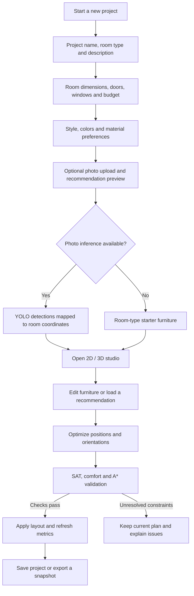

# SmartSpace AI

### Plan a room. Arrange furniture. Check how the space works.

SmartSpace AI is an interior layout planning application with a four-step project wizard, an interactive 2D/3D studio, optional photo-based furniture detection, and a spatial optimizer. Enter room measurements, choose your preferences, and build a layout that considers furniture fit, viewing direction, and walking access.

[Getting started](#getting-started) · [Project workflow](#project-workflow) · [Algorithms](#how-the-layout-optimizer-works) · [Tech stack](#tech-stack) · [API](#main-api-endpoints)

## Features

- **Four-step project wizard** — Enter project details, room measurements in feet, budget in INR, design preferences, and an optional room photo. New project inputs start empty.
- **Interactive design studio** — Edit a proportional HTML5 Canvas floor plan, switch to a Three.js view, and add, move, rotate, replace, or delete furniture.
- **Detailed furniture assets** — Top-down SVG furniture scales and rotates with the same footprints used by collision detection.
- **Responsive furniture panel** — Manage furniture beside the floor plan on desktop, with a stacked layout on smaller screens.
- **Catalog and recommendations** — Browse at least 50 seeded furniture variants across ten classes and preview room-specific recommendation bundles.
- **Collision and comfort checks** — Evaluate rotated furniture bounds, room boundaries, sofa–TV viewing, usable furniture access, and walking paths.
- **Optional YOLO photo analysis** — Detect supported objects from an uploaded photo, with a room-type starter layout when photo inference is unavailable.
- **Accounts and project history** — Register, sign in, save designs, and resume them in the studio.
- **Live feedback** — View estimated furniture cost, layout metrics, circulation paths, clearance outlines, and facing arrows.
- **Architectural interior design specifications** — Complete guidelines for all 8 room types (Living Room, Bedroom, Master Bedroom, Kitchen, Bathroom, Dining Room, Home Office, Studio Apartment) with 3-tier lighting, materials, 60-30-10 palettes, and AI visualization prompts. See [Interior Design Specifications](docs/INTERIOR_DESIGN_SPECIFICATIONS.md).

## Project workflow



The photo shown in the studio is the project's uploaded photo. Floor plans are rendered from furniture geometry; the application does not generate photorealistic room images with a generative image API.

## Tech stack

| Layer | Implementation |
| --- | --- |
| Backend | Python, Flask 3.x, blueprint-based routes |
| React interface | React 19, TypeScript, Vite 7, Tailwind CSS 4, Framer Motion |
| Studio rendering | Vanilla JavaScript, HTML5 Canvas, Three.js |
| Persistence | SQLite through Python's built-in `sqlite3` module |
| Authentication | Flask signed-cookie sessions and Werkzeug scrypt password hashes |
| Photo detection | Optional Ultralytics YOLO; optional ONNX runtime |
| Layout engine | NumPy, oriented SAT geometry, A* pathfinding, bounded placement search, DQN support |

The frontend is hybrid: React components are mounted inside Flask templates, while the existing Canvas and Three.js editors share layout data through JavaScript events. SQLite is the implemented database backend; SQLAlchemy and PostgreSQL are not required.

## Getting started

### 1. Clone the repository

```bash
git clone https://github.com/SwarajDudhmal/SmartSpace-AI.git
cd SmartSpace-AI
```

### 2. Create a Python environment

Use Python 3.12 for the local setup.

**Windows PowerShell**

```powershell
py -3.12 -m venv .venv
.\.venv\Scripts\python.exe -m pip install -r requirements.txt
.\.venv\Scripts\python.exe app.py
```

**macOS / Linux**

```bash
python3.12 -m venv .venv
source .venv/bin/activate
python -m pip install -r requirements.txt
python app.py
```

Open **[http://127.0.0.1:5000](http://127.0.0.1:5000)**. Run the application from the repository root and access pages through Flask so templates and static assets load correctly.

The application initializes its SQLite tables and catalog on startup. The compiled frontend in `static/dist/` is included, so Node.js is only needed when editing and rebuilding the React interface.

### 3. Optional: enable photo detection

Install the vision dependencies using the same Python environment that launches Flask:

```powershell
.\.venv\Scripts\python.exe -m pip install -r requirements-vision.txt
```

On macOS/Linux with the environment activated, use `python -m pip install -r requirements-vision.txt`.

The detector prefers a custom checkpoint at `data/models/yolo_interior.pt` or `data/models/yolo_interior.onnx`. When no custom checkpoint is available, it attempts to download `yolov8n.pt` through Ultralytics. The first download requires an internet connection. ONNX inference additionally requires `onnxruntime`.

The pretrained fallback maps detections for **bed, sofa, chair, table, and TV**. Detecting all ten project classes requires an appropriate custom-trained model. If dependencies, weights, download, or inference are unavailable, the application uses starter furniture and reports the fallback.

### 4. Optional: rebuild the React frontend

Use Node.js **20.19+ within the 20.x line, or 22.12+**, matching the Vite version in the lockfile, and install pnpm.

```bash
cd frontend
pnpm install --frozen-lockfile
pnpm run build
cd ..
```

Vite writes the JavaScript and CSS bundles into `static/dist/`, which Flask serves to the homepage, wizard, dashboard, and studio. After rebuilding, refresh the browser to load the updated assets.

### 5. Optional: seed replay data

Run with your project Python environment:

```bash
python scripts/seed_database.py
```

This initializes the catalog, curated presets, and offline replay transitions. Bundled dimensions and INR costs are illustrative project data, not live retail prices or imported 3D-FRONT/3D-FUTURE records. See the [database and recommendation guide](docs/database-and-recommendations.md) for catalog imports and schema details.

## How the layout optimizer works

Optimization evaluates more than whether furniture rectangles overlap:

| Stage | What it does |
| --- | --- |
| **SAT collision detection** | Checks rotated furniture footprints and room-boundary containment. |
| **Placement repair** | Uses bounded placement search and backtracking to separate overlapping items without resizing or removing them. |
| **Joint arrangement search** | Tries room-wide positions and multiple orientations, including direct 180° changes that small moves can miss. |
| **Viewing and comfort checks** | Checks mutual sofa–TV facing, viewing distance, sightline obstacles, front access, bed placement, and chair–desk relationships. |
| **A* circulation** | Checks routes from the entry to usable furniture sides on an occupancy grid that accounts for the configured 0.75 m walking width. |
| **Local refinement** | Improves the combined reward while preserving geometric validity and avoiding comfort regressions. A trained DQN, when installed, supplies action tie-breaking scores. |
| **Final validation** | Applies an optimized result only when geometry and comfort checks pass; otherwise reports unresolved constraints and preserves the user's plan. |

Sofa–TV checks use a **30° forward cone** and the viewing-distance range configured in `config.py` (currently **1.5–3.8 m**). The engine also penalizes blocked doors, daylight obstruction by tall storage, and budget overruns.

The optimizer is a time-bounded heuristic. It searches for a valid, better arrangement; it does not prove a global optimum. Failure within the search budget does not prove that a room is impossible to furnish. A* uses an approximate grid, and photo-derived positions are estimates that users can adjust.

### 133-dimensional state and 48 actions

The DQN state contains:

```text
5 room features + 8 furniture slots × 16 features = 133 values
```

- **Room features:** width, length, budget, and two normalized entry coordinates.
- **Each furniture slot:** position, width, depth, rotation, ten class indicators, and a presence flag.
- **Actions:** six actions per slot — shift ±X, shift ±Y, rotate +90°, and snap to a wall.
- **Capacity:** the optimizer supports up to eight furniture items; larger submissions are rejected rather than silently truncated by the optimization endpoint.

The ten catalog classes are `bed`, `sofa`, `chair`, `table`, `wardrobe`, `desk`, `tv`, `cabinet`, `door`, and `window`. Room openings and other configuration also remain available outside the encoded state.

### Model availability

Recommendations use catalog selection and curated spatial rules, with DQN refinement when a compatible trained checkpoint is available. The repository does not bundle a trained 3D-FRONT VAE or layout Transformer. A trained DQN is optional; spatial search remains available without one.

To train the DQN and save its checkpoint and training history under `data/models/`:

```bash
python engine/train_dqn.py --episodes 50 --steps 30
```

For custom YOLO training, prepare labeled images using `vision/dataset_tools/`, then run:

```bash
python vision/dataset_tools/train_yolo.py --data data/yolo_dataset/data.yaml --epochs 50
```

The training script defaults to a YOLO11 configuration initialized from scratch. Training quality depends on the dataset; bundled examples are not evidence of benchmark-level performance.

## Project structure

```text
SmartSpace-AI/
├── app.py                       # Flask application factory and startup
├── config.py                    # Furniture specifications and ergonomic rules
├── database/                    # SQLite catalog, replay, users and project history
├── engine/
│   ├── interior_env.py          # MDP state, actions and rewards
│   ├── dqn_agent.py             # DQN support and optimization trajectory
│   ├── sat_collision.py         # Rotated footprints and spatial checks
│   ├── layout_repair.py         # Collision and boundary repair
│   ├── layout_comfort.py        # Viewing, access and joint arrangement search
│   ├── furniture_orientation.py # Asset-aligned headings and approach points
│   ├── astar_planner.py         # Walking-path evaluation
│   └── recommender.py           # Catalog-based recommendation bundles
├── frontend/                    # React/TypeScript source and Vite configuration
├── routes/                      # Auth, projects, recommendations, jobs and views
├── static/
│   ├── assets/furniture/        # Top-down SVG furniture
│   ├── dist/                    # Compiled React assets served by Flask
│   └── js/                      # Canvas/Three.js studio and API integration
├── templates/                   # Flask pages and React mounting points
├── vision/                      # Photo detection and dataset/training tools
├── scripts/seed_database.py     # Catalog, preset and replay seeding
├── docs/                        # Architecture diagrams and database guide
└── tests/                       # Existing automated test suite
```

## Main API endpoints

| Endpoint | Purpose |
| --- | --- |
| `POST /api/projects` | Capture project basics |
| `POST /api/rooms` | Prepare a room from the submitted requirements |
| `POST /api/detect` | Process an uploaded room photo |
| `POST /api/recommendations` | Generate furniture/layout recommendations |
| `POST /api/evaluate` | Calculate layout metrics and design advice |
| `POST /api/optimize` | Search for a validated arrangement |
| `GET /api/jobs/<job_id>` | Poll queued model/search work |
| `GET /api/system-status` | Inspect available model capabilities |
| `POST /api/auth/register`, `POST /api/auth/login` | Account registration and sign-in |
| `GET /api/project-history`, `POST /api/project-history` | List or save a user's projects |
| `GET /api/project-history/<history_id>` | Load a saved project |

Long-running operations may return **HTTP 202** for background processing. The shared frontend API helper polls for completion. An unresolved optimization returns **HTTP 422** with an explanation.

## Local configuration

| Variable | Purpose |
| --- | --- |
| `SMARTSPACE_DB_PATH` | Override the default `data/smartspace.sqlite3` database path |
| `SMARTSPACE_SECRET_KEY` | Supply a persistent Flask session secret; local startup otherwise creates `data/.session_secret` |
| `SMARTSPACE_COOKIE_SECURE` | Set to `true` when serving the application over HTTPS |

Local databases, session secrets, uploaded files, virtual environments, and model weights are excluded from Git. The included `python app.py` command starts Flask's local development server.

## Documentation

- [Database and recommendations](docs/database-and-recommendations.md)
- [Workflow diagram](docs/smartspace_ai_workflow.svg)
- [Real-time sequence diagram](docs/smartspace_ai_realtime_sequence.svg)
- [System architecture](docs/smartspace-architecture.png)
- [Source provenance](SOURCE.md)
